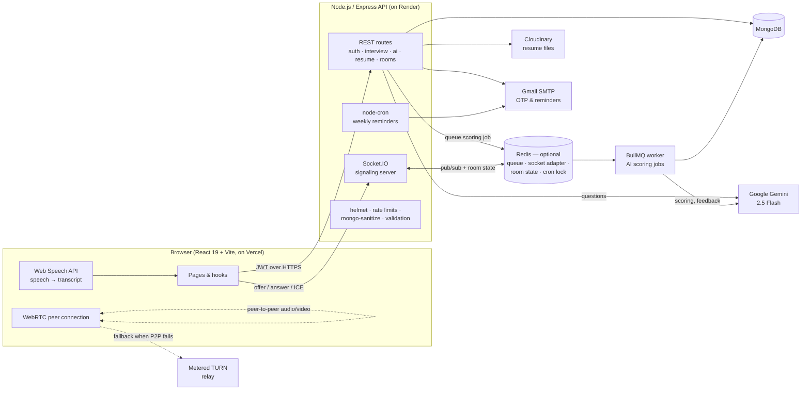

# 🤖 AI Interview Platform

> Practice real interview questions by voice, get AI-scored feedback, and run live video mock interviews with a friend.

[](https://github.com/aditiyadavz/ai-interview-platform/actions/workflows/ci.yml)

**🌐 Live demo → [ai-interview-platform-eta-green.vercel.app](https://ai-interview-platform-eta-green.vercel.app)**
&nbsp;·&nbsp; Click **“Try Demo Account”** on the login page — no signup needed.

> ⏳ The API runs on Render's free tier, which sleeps when idle. The **first request can take ~30–50 s** while it wakes up; after that it's fast.

<!--
  TODO: add a 60–90 s demo GIF/video here, e.g.
  
  Suggested flow: demo login → pick a role → answer 2 questions by voice →
  scorecard → progress page → create a friend room.
  Record with ScreenToGif (Windows) or OBS, keep it under ~10 MB.
-->

---

## ✨ What it does

| | |
|---|---|
| 🎙️ **Voice mock interviews** | Pick a role and difficulty, answer questions out loud. Speech is transcribed in the browser and each answer is scored by Google Gemini on the server. |
| 🏢 **Company mode** | Bias questions towards the publicly known interview style of Google, Amazon, Microsoft, Meta, Netflix, or a startup. |
| 📄 **Resume-based interviews** | Upload a resume and get a technical + HR round generated from your own skills and projects, with **proctoring**: fullscreen enforcement, tab-switch detection, copy/paste blocking, and auto-submit after 3 violations. |
| 👥 **Live interview with a friend** | Create a room, share a link, and run a two-person **WebRTC** video interview with synced questions, private notes, 1–5 star ratings and chat. The guest needs no account. |
| 📈 **Progress tracking** | Daily streaks, score trend, per-role averages and weak-topic analysis. |
| 🏆 **Achievements & leaderboard** | Badges, downloadable certificates for scores ≥ 70, and a ranked leaderboard of AI-scored interviews. |
| 📤 **Shareable scorecards** | “Wrapped”-style image rendered client-side: share, download, or post to LinkedIn. |
| 📧 **Email** | OTP-verified signup and password reset, optional weekly practice reminders (cron, Mondays 09:00), working contact form. |

---

## 🏗️ Architecture



**A solo interview, end to end**

1. `POST /api/ai/questions` — Gemini generates role/difficulty/company-specific questions (falls back to a curated pool if the API is down).
2. `POST /api/interview/start` — the interview and its questions are stored.
3. The browser transcribes each spoken answer and shows instant local metrics.
4. `POST /api/interview/:id/submit` — the server **ignores any client-sent scores**, atomically marks the interview `pending` (so a double-click can't score it twice) and puts a scoring job on the **BullMQ** queue, returning `202` straight away.
5. A worker re-scores every transcript with Gemini (3 at a time), writes session feedback, then updates the streak, badges and notifications. Jobs retry with exponential backoff.
6. The client polls `GET /api/interview/:id/result`, starting at 1 s and slowing to 4 s, until it shows `done`.

Without Redis, steps 4–5 run inside the submit request and the response already contains the score, so the client code is the same either way.

**A friend interview**

The host creates a room (`POST /api/friend-room/create`) and shares a 6-character code. Both peers connect to the Socket.IO signaling server, which only relays WebRTC offers/answers/ICE candidates and keeps the interview state in sync (current question, notes, ratings), so a peer who reconnects picks up where they left off. With Redis, the **Socket.IO Redis adapter** relays events between API instances and the room state lives in Redis, so the two peers can be connected to different instances. Media flows peer-to-peer; when a direct connection isn't possible (strict NATs, mobile networks), a TURN relay from Metered is used, falling back to a public relay if Metered isn't configured.

---

## 🧠 Engineering decisions

| Decision | Why |
|---|---|
| **Score on the server, never trust the client** | The browser's score is only shown as a preview. On submit, answers are whitelisted field by field, question text comes from the stored interview, and Gemini scores each transcript. If Gemini fails, a heuristic **capped at 60** is used, so an outage can never inflate a score. |
| **Prompt-injection defence** | Transcripts are put between `<answer>` delimiters (any copies of those tags inside the transcript are stripped out first) and the model is told to give 0 to answers that try to instruct it. |
| **Authenticated signaling** | Socket connections carry the JWT. Only the room's real host can join as host, and once a guest has registered, their slot is reserved for them. Guests without an account can still join open rooms. |
| **Layered rate limits** | Separate limits for auth (20 / 15 min), OTP email (5), AI-cost endpoints including submit (40), contact form (5) and TURN credentials (30), on top of a general 300 / 15 min. |
| **OTP-verified signup** | An account is only created after a 6-digit code (10-minute expiry, stored with a TTL index) is confirmed. Password reset gives the same response whether or not the email exists, so it can't be used to discover accounts. |
| **Passwordless, read-only demo account** | Recruiters can look around in one click. The server logs into the account flagged `isDemo` — no password is shipped to the browser — and blocks password, profile, resume and testimonial changes for it. Its sample data is excluded from the public homepage stats. |
| **A leaderboard that's hard to game** | Ranking is computed with a MongoDB aggregation and only counts AI-scored solo and resume interviews. Friend-room sessions (human ratings, plus a fixed 100 for the interviewer) and the demo account are excluded, and the bonus for number of sessions stops growing after 20. |
| **Slow AI work on a background queue** | Scoring makes one Gemini call per answer plus one for feedback, which often takes 10–30 s. Running it in a BullMQ worker keeps the API fast. The job id is the interview id, so the same interview can never be queued twice. The finalizing step is safe to run twice, so a retried job never re-scores or double-counts a streak. |
| **Redis is optional, and the app keeps working when it fails** | Without `REDIS_URL` everything runs in a single process exactly as before. If Redis is configured but unreachable, queueing times out after 3 s and the submit is scored inline, so users aren't stuck waiting (there's a test for this). |
| **Ready for multiple instances** | With Redis: the Socket.IO adapter for cross-instance events; room seats, progress and notes in Redis hashes with TTLs, where an atomic Lua script frees a seat only if it's still held by the disconnecting socket; and a lock (`SET NX EX`) so the Monday reminder email is sent once, not once per instance. |
| **Graceful shutdown** | On `SIGTERM` (deploys) the API stops taking connections, lets the worker finish its current job, then closes Redis and MongoDB. |
| **WebRTC peer-to-peer + TURN fallback** | Keeps video traffic and cost off the server, and still connects users on restrictive networks. |

### Known limitations / next steps

- The Redis-backed code paths (queue, adapter, Redis room store) are tested against a real Redis in CI. Locally those tests are skipped unless `REDIS_URL` is set.
- Polling for the result is simple and robust. Pushing a "scored" event over the existing socket would be faster.
- The auth token is stored in `localStorage`. httpOnly cookies + refresh tokens would reduce the risk from XSS.
- Scoring quality hasn't been benchmarked against human graders yet.

---

## 🧱 Tech stack

| Layer | Technology |
|---|---|
| Frontend | React 19, Vite 7, React Router 7, Recharts, Framer Motion, Web Speech API |
| Backend | Node.js, Express 4, Socket.IO 4, node-cron |
| Queue & scaling | Redis (optional), BullMQ, `@socket.io/redis-adapter`, ioredis |
| Real-time video | WebRTC (peer-to-peer), Socket.IO signaling, Metered TURN |
| Database | MongoDB + Mongoose 8 |
| AI | Google Gemini 2.5 Flash (`@google/genai`) |
| Auth & security | JWT, bcryptjs, OTP email verification, helmet, express-rate-limit, express-validator, express-mongo-sanitize |
| Files & email | Cloudinary (resumes), Nodemailer + Gmail SMTP |
| Testing & CI | Jest, Supertest, mongodb-memory-server, Vitest, ESLint, GitHub Actions |
| Deployment | Vercel (client), Render (API) |

---

## 📁 Project structure

```
ai-interview-platform/
├── client/                     React app (Vite)
│   └── src/
│       ├── pages/              One component per route
│       ├── components/         Shared UI (navbar, interview widgets, …)
│       ├── hooks/              useRecorder (speech), useWebRTC, useProctor, …
│       ├── services/           API clients, one per backend area
│       └── utils/              Local answer analysis, formatting, scorecard image
├── server/
│   ├── src/
│   │   ├── routes/ → controllers/ → services/ → models/
│   │   ├── middleware/         auth, demo guard, validation, errors
│   │   ├── sockets/            WebRTC signaling server + room store (memory / Redis)
│   │   ├── config/             MongoDB, Redis, Gemini, Cloudinary, mailer
│   │   └── worker.js           Optional standalone scoring worker
│   ├── scripts/                seedDemoData.js and maintenance scripts
│   └── tests/                  Jest + Supertest suites
└── .github/workflows/ci.yml
```

---

## 🚀 Running it locally

**Prerequisites:** Node.js 20+, a MongoDB connection string (local or a free Atlas cluster), and a [Gemini API key](https://aistudio.google.com/app/apikey).

```bash
git clone https://github.com/aditiyadavz/ai-interview-platform.git
cd ai-interview-platform

# API
cd server
npm install
# create server/.env (see below), then:
npm run dev            # http://localhost:5000

# Client (in a second terminal)
cd client
npm install
echo VITE_API_URL=http://localhost:5000/api > .env
npm run dev            # http://localhost:5173
```

**Optional — Redis (background scoring + multi-instance sockets):** run Redis locally (e.g. `docker run -p 6379:6379 redis:7-alpine`), set `REDIS_URL=redis://localhost:6379` and restart the API. The scoring worker runs inside the API process. To run it separately, start `npm run worker` and set `RUN_WORKER=false` on the API.

**Optional — demo account:** `cd server && npm run seed`, then set `DEMO_LOGIN_ENABLED=true` and restart the API. The “Try Demo Account” button will log in to a read-only account with sample history. Re-run the seed at any time to reset it.

### Environment variables

**Server (`server/.env`)**

| Variable | Required | Description |
|---|---|---|
| `MONGO_URI` | ✅ | MongoDB connection string |
| `JWT_SECRET` | ✅ | Long random string for signing JWTs |
| `GEMINI_API_KEY` | ✅ | Google Gemini API key |
| `CLIENT_URL` | ✅ | Allowed frontend origin(s), comma-separated (CORS + room links) |
| `PORT` | | API port (default `5000`) |
| `NODE_ENV` | | Set to `production` in deployment (hides stack traces) |
| `EMAIL_USER` / `EMAIL_PASS` | for email | Gmail address + [App Password](https://support.google.com/accounts/answer/185833) — needed for signup OTPs, password reset, reminders, contact form |
| `EMAIL_SERVICE` | | Nodemailer service (default `gmail`) |
| `ADMIN_EMAIL` | | Account allowed to trigger the reminder batch manually (contact-form messages go to `EMAIL_USER`) |
| `CLOUDINARY_CLOUD_NAME` / `_API_KEY` / `_API_SECRET` | for resumes | Cloudinary credentials for resume uploads |
| `METERED_APP_NAME` / `METERED_API_KEY` | | Metered TURN credentials. If unset, a public relay is used |
| `DEMO_LOGIN_ENABLED` | | `true` to enable one-click demo login (run `npm run seed` first) |
| `REDIS_URL` | | e.g. `redis://localhost:6379` or a hosted `rediss://` URL. Turns on the scoring queue, the Socket.IO Redis adapter and shared room state. Unset = single instance, inline scoring |
| `SCORING_MODE` | | `inline` to keep scoring in the request even when Redis is set |
| `RUN_WORKER` | | `false` to not run the scoring worker inside the API (use `npm run worker` instead) |
| `SCORING_CONCURRENCY` | | Jobs a worker scores in parallel (default `2`) |

**Client (`client/.env`)**

| Variable | Required | Description |
|---|---|---|
| `VITE_API_URL` | ✅ | API base URL, e.g. `http://localhost:5000/api` |

---

## 🧪 Testing & CI

**Server** — Jest + Supertest against a throwaway in-memory MongoDB (`mongodb-memory-server`). Gemini and email are mocked, so the tests need no API keys or network access.

```bash
cd server
npm test                # run all suites
npm run test:coverage   # with a coverage report in server/coverage/
```

| Suite | What it checks |
|---|---|
| `auth.test.js` | Login (incl. case-insensitive email), generic errors (no account enumeration), OTP-gated signup, JWT protection |
| `interview.test.js` | Server-side scoring ignores client-sent scores, empty/duplicate submissions rejected, users can't read or submit each other's interviews |
| `scoreAnswers.test.js` | Input whitelisting, score clamping, capped fallback when Gemini fails, prompt-injection delimiter stripping |
| `friendRoom.test.js` | Only room members can finish a friend interview, forged `guestUserId` ignored, ratings clamped, guest-slot rules |
| `signaling.test.js` | Socket.IO `room:join` auth — only the real host can join as host, guest slot reserved for the registered guest |
| `leaderboard.test.js` | Ranking order, demo account and friend-room interviews excluded (including older friend interviews), session-volume cap |
| `scoringFlow.test.js` | Result endpoint, racing double-submits score once, a failed scoring can be resubmitted, a stuck `pending` can be reclaimed, finalizing twice changes nothing, resume submit shares the flow |
| `roomStore.test.js` | The same contract for the memory and Redis room stores: seats, reconnect takeover, per-question notes, isolation, TTLs |
| `redis.integration.test.js` | *(real Redis)* submit → `202` → worker scores → `done`; no duplicate jobs; **two Socket.IO instances**: peers on different instances connect, relay signaling, share state, and a full room is enforced across instances; once-per-week cron lock |
| `redisDown.test.js` | Redis configured but unreachable → submit still succeeds within seconds via inline scoring |
| `demo.test.js` | Passwordless demo login only when enabled, demo account can't change password/profile/resume/testimonials or be reset, sample data excluded from stats |

**Client** — Vitest unit tests for the local answer analysis, formatting utilities and result polling (`waitForScoring`), plus ESLint.

```bash
cd client
npm test
npm run lint
```

**CI** — GitHub Actions ([`.github/workflows/ci.yml`](.github/workflows/ci.yml)) runs the server tests with coverage against a **Redis service container** (so the Redis integration tests run there), and client lint + tests + production build, on every push to `main` and every pull request.

---

## 🗺️ App pages

| Route | Page | Description |
|---|---|---|
| `/` | Home | Landing page with features, live platform stats, testimonials |
| `/login`, `/signup`, `/forgot-password` | Auth | Login (+ demo), OTP signup, OTP password reset |
| `/dashboard` | Dashboard | Personal stats and quick actions |
| `/roles` | Roles | Pick a target job role |
| `/interview-setup/:role` | Interview Setup | Difficulty, company mode, device check |
| `/interview-room/:role` | Interview Room | Live session with timer and voice recording |
| `/feedback/:role` | Feedback | AI breakdown of each answer, share your experience |
| `/scorecard/:role` | Score Card | Score summary + share / download / LinkedIn |
| `/resume-interview/setup` → `/room` → `/results` | Resume Interview | Resume-based, proctored technical + HR rounds |
| `/interview-history`, `/interview/:id` | History | Past interviews with charts, and per-interview detail |
| `/progress` | Progress | Streaks, score trend, weak-topic analysis |
| `/achievements` | Achievements | Badges, certificates and the leaderboard |
| `/profile` | Profile | Resume upload, skills, links, reminder & password settings |
| `/friend-interview/create` | Create Room | Host sets up a live interview (login required) |
| `/friend-interview/join/:code`, `/room/:code` | Friend Room | Join via link (no account needed) and the live call |
| `/contact` | Contact | Contact form (sends a real email) |

---

## 🛣️ Roadmap

- [x] Resume-based interviews with proctoring
- [x] Live interview with a friend (WebRTC + TURN)
- [x] Progress dashboard with streaks & weak-topic analysis
- [x] Shareable “Wrapped”-style scorecards
- [x] Company-specific interview simulation
- [x] Automated tests + CI
- [x] Leaderboard
- [x] Background AI-scoring queue (BullMQ)
- [x] Redis-backed Socket.IO for multiple instances
- [ ] Benchmark AI scoring against human-graded answers
- [ ] Video recording & playback of interviews
